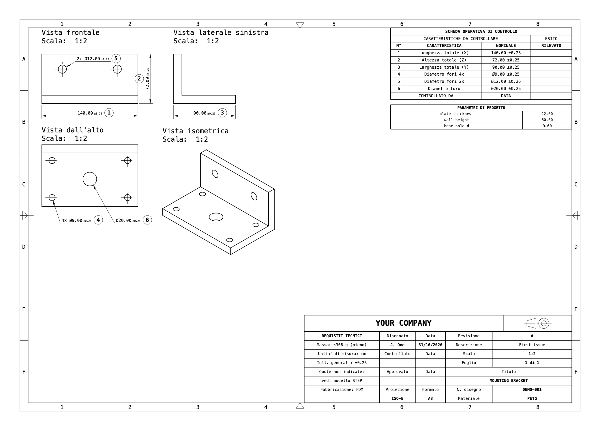
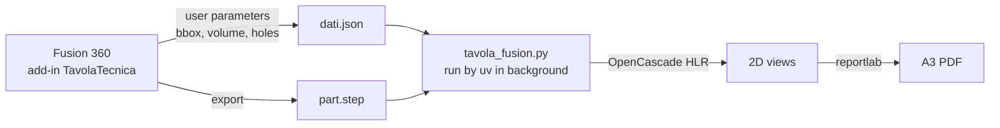

<div align="center">

# Fusion 360 Drawing Generator

**One click in Fusion 360 → a dimensioned A3 technical drawing (PDF) of the active design.**




<sub>Sheet generated by <code>examples/demo.py</code> (no Fusion needed).</sub>

</div>

---

## Why

Fusion's own drawing workspace is powerful but slow for the everyday case: *"I need a clean,
dimensioned sheet of this part, now"*. This add-in puts a **Genera tavola** (*Generate drawing*)
button in the toolbar. It reads the model and its user parameters, computes the views with
hidden-line removal and writes a ready-to-print PDF. Nothing to set up per project, and no files
left around except the PDF.

## Features

- 📐 **Three orthographic views + isometric**, first-angle projection (ISO-E), with hidden-line removal by OpenCascade.
- 🔍 **Automatic ISO 5455 scale** (2:1, 1:1, 1:2, 1:5…) and an adaptive layout that fills the sheet. The isometric view goes in the largest free spot next to the views.
- 📏 **Automatic dimensions**: overall X/Y/Z sizes, plus holes recognised from the B-rep. Holes are grouped by diameter, and the leader goes to the view where each hole is seen face-on; hidden holes are drawn dashed.
- ✅ **Inspection sheet** ("scheda operativa di controllo"): every dimension is numbered with a balloon and listed with its tolerance and an empty *measured* column.
- 🧮 **Design parameters table** with the Fusion user parameters (anything prefixed `calc_` is skipped).
- 🏷️ **Title block** with company, author, title, drawing number, material, estimated mass, revision and date.
- 💾 **Settings are stored in the design itself** (Fusion attributes), so the dialog is pre-filled the next time. There are no config files in your project folders.
- ⚡ **Non-blocking**: Fusion only exports a STEP. The heavy work runs in a background process and the PDF opens when it is ready.
- 🧩 **Custom recipes**: a Python file per part when you need special views or dimensions.

## How it works



Fusion's embedded Python cannot install OpenCascade or reportlab. So the add-in only collects the
data, with a small `QUERY` snippet that runs inside Fusion, and starts `uv run tavola_fusion.py
--dati …`. [uv](https://docs.astral.sh/uv/) creates the isolated environment on first use.

## Requirements

- macOS (Apple Silicon or Intel) with **Autodesk Fusion 360**
- [**uv**](https://docs.astral.sh/uv/) (`brew install uv`). The first run downloads `cadquery-ocp`, `reportlab` and `numpy`.

## Installation

```bash
git clone https://github.com/matteoimmorlano/fusion360-drawing-generator.git
cd fusion360-drawing-generator

# make the add-in visible to Fusion (a symlink, so a git pull updates it)
ln -s "$PWD/addin/TavolaTecnica" \
  ~/Library/Application\ Support/Autodesk/Autodesk\ Fusion\ 360/API/AddIns/TavolaTecnica
```

In Fusion, open **Utilities → Add-Ins** (`Shift+S`), go to the **Add-Ins** tab and select
**TavolaTecnica**. Click **Run**, and tick **Run on Startup**.

> If the add-in does not show up, click the **+** button in that dialog and pick the
> `addin/TavolaTecnica` folder directly.

## Usage

1. Open the part's design and bring it to the front.
2. Click **SOLID → TAVOLA → Genera tavola**.
3. Fill in the dialog. After the first time it remembers everything:

   | Field | Meaning |
   |---|---|
   | Intestazione / Disegnato da | Company name and author. Remembered for **all** new parts |
   | Titolo, N. disegno | Title and drawing number |
   | Materiale, Densità, Fabbricazione | Material, density (g/cm³, used for the mass), process |
   | Nota | Free note in the title block |
   | Tipo tavola | `Standard` or one of the recipes in `ricette/` |
   | Revisione, Descrizione | Revision letter and description |
   | Cartella progetto | Project folder. The PDF goes to `<folder>/03_Disegno_tecnico/<name>_tavola_A3_rev<REV>.pdf` |

4. Click **Genera**. You get a notification and the PDF opens when it is ready.
5. **Save the design** so the dialog values are stored in it.

## Try it without Fusion

```bash
./examples/demo.py demo.pdf
```

The demo builds a bracket with OpenCascade and draws it with the same engine. This is how the
image above was made.

## Custom recipes

When the standard sheet is not enough, add a Python file to `ricette/` and select it in
**Tipo tavola**. A recipe can define:

| Name | Purpose |
|---|---|
| `QUERY` *(optional)* | Code run **inside Fusion** that fills the `extra` dict (it has access to `des`, `root`, `P`, `adsk`). Without it, the standard query is used. |
| `VISTE` | Views to project: `{key: (view_dir, x_dir)}`, or a function of the parameters |
| `disegna(sh, P, G, PJ, meta, cfg)` | Draws the sheet using the `Sheet` primitives in `tavola.py` |

See [`ricette/example_note.py`](ricette/example_note.py) for a minimal recipe that extends the
standard sheet. Recipes other than `example_*.py` are git-ignored, so your own and your clients'
parts stay private.

## Command line

The engine can also run from a terminal. It then talks to Fusion through the socket of the
[Fusion360MCP](https://github.com/faust-machines/fusion360-mcp-server) add-in and reads a
`tavola.json` file from the project folder:

```bash
./tavola_fusion.py "/path/to/project" --rev B --descrizione "Holes enlarged" --apri
```

## Project layout

```
├── addin/TavolaTecnica/   Fusion add-in: button, dialog, data collection (core.py)
├── tavola_fusion.py       engine entry point (uv script)
├── generico.py            standard layout: views, scale, dimensions, tables, title block
├── tavola.py              drawing primitives: frame, tables, dimensions, leaders, balloons
├── hlr.py, polyhlr.py     hidden-line removal (exact, plus a mesh-based fallback)
├── ricette/               custom recipes (only example_*.py is tracked)
└── examples/demo.py       end-to-end demo without Fusion
```

## Limitations

- **macOS only**. It uses the Menlo font, `osascript` notifications and `open`.
- The **UI and the sheet labels are in Italian**.
- Holes are found as concave cylindrical faces (≥ 300°). Holes whose axis is not along X/Y/Z are listed in the inspection table as *"vedi STEP"* but get no leader.
- One part per sheet, A3, first-angle projection.

## License

[MIT](LICENSE) © 2026 Matteo Immorlano
